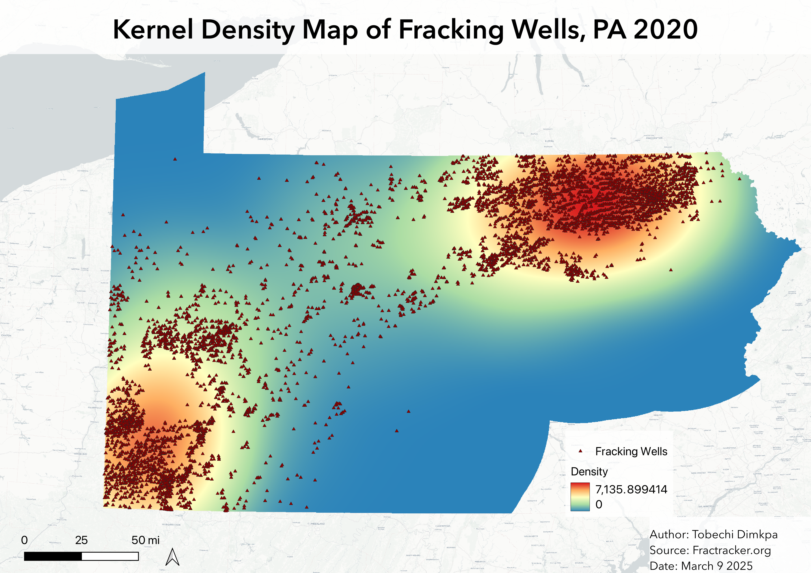
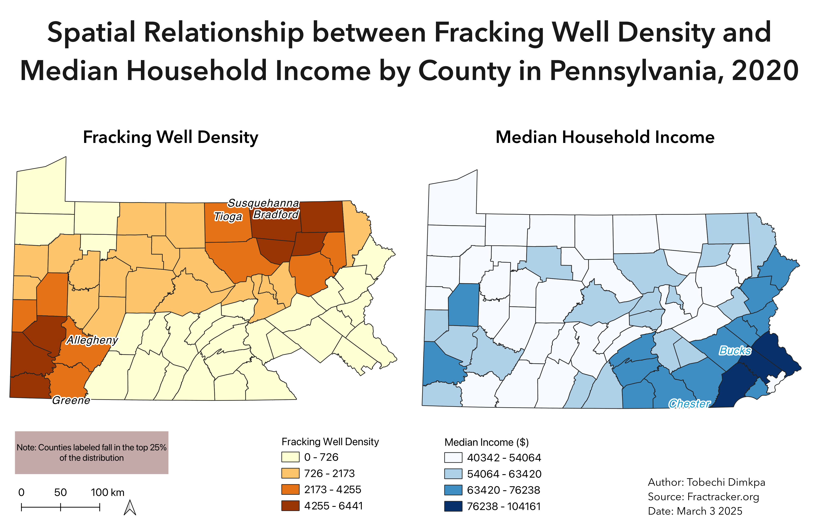
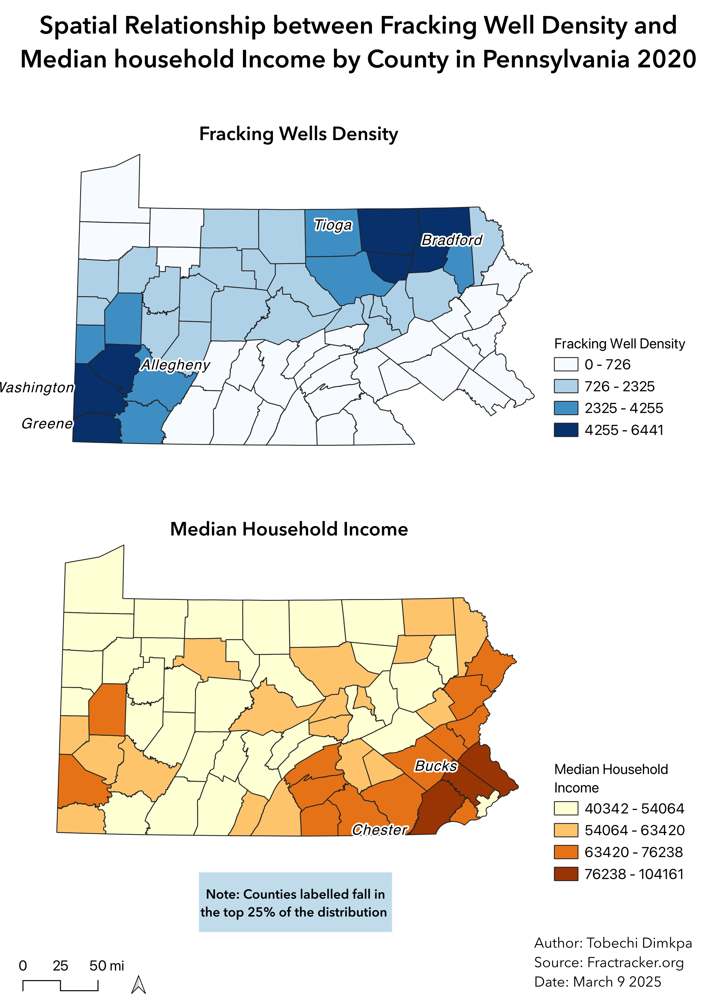
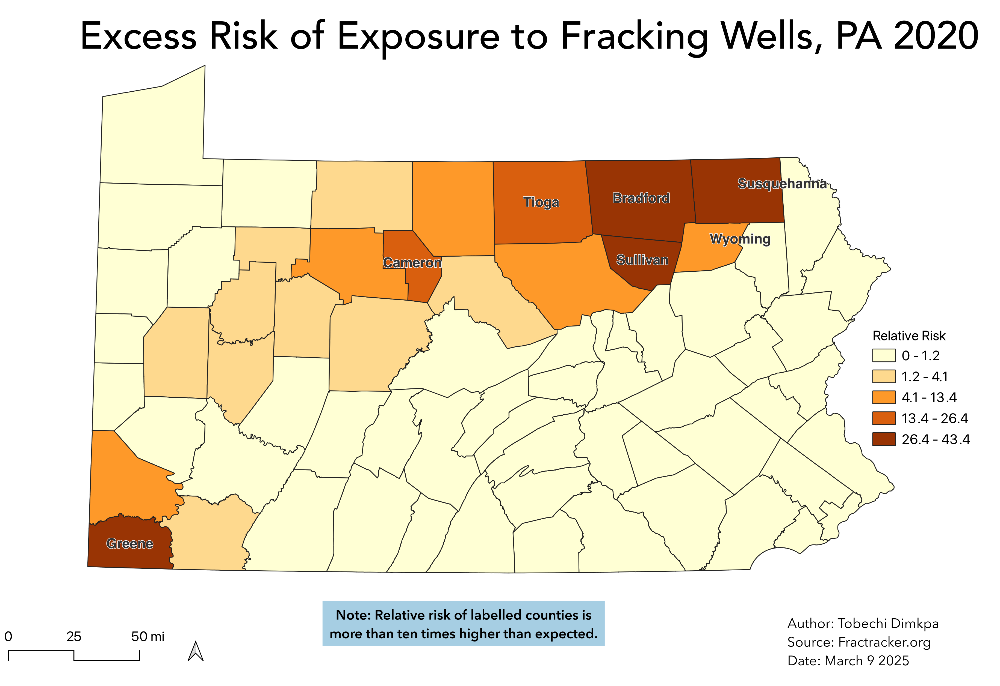
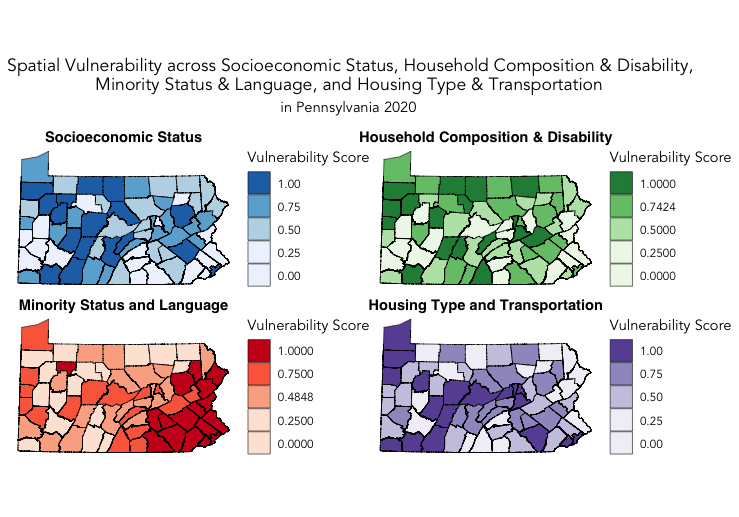

# Fracking Wells, Household Income, and Social Vulnerability in Pennsylvania

Spatial analysis of where fracking wells are concentrated across Pennsylvania's 67 counties, how well density relates to median household income, and how social vulnerability varies by county.

## Research question

Where are fracking wells concentrated in Pennsylvania, and do the counties with the most wells differ in median household income and social vulnerability from the rest of the state?

## Data

- **Fracking wells:** `fracking_wells.shp` — **23,379 wells**, 3 fields. Source as cited in the analysis script: **Fractracker.org**.
- **Counties:** `PA_county.shp` — **67 counties**. Both shapefiles use NAD83 (NSRS2007) / Pennsylvania North (EPSG: 3650), units in feet.
- **Median household income by county, 2020** — shown on the comparison maps; ranges from **$40,342 to $104,461**.
- **Social vulnerability:** `data/PA_vulnerability.csv` — one row per county (67 rows) with FIPS code and four vulnerability scores on a 0–1 scale:
  - `SES` — socioeconomic status
  - `household` — household composition & disability
  - `minority` — minority status & language
  - `housing` — housing type & transportation
- The vulnerability CSV is joined to the county shapefile on county name (`NAME` = `COUNTY`) in `MIDTERM.R`.

## Methods

All analysis is in `MIDTERM.R` (R, with map finishing in QGIS):

1. **Kernel density estimation (KDE)** — `sfhotspot::hotspot_kde()` on the well points, 20,000-unit cells, hexagonal grid, bandwidth adjustment 1.5, clipped to Pennsylvania counties and classed by Jenks natural breaks (5 classes).
2. **Hotspot analysis** — Getis-Ord Gi\* (`sfhotspot::hotspot_gistar()`, same 20,000-unit hex grid), keeping only statistically significant hotspots (Gi\* > 0, p < 0.05).
3. **County well counts and income comparison** — wells aggregated to the county level and mapped side-by-side with median household income (2020), with the top 25% of counties labelled on each map.
4. **Relative risk of exposure** — county-level relative risk of exposure to fracking wells, mapped in `maps/midterm3.png` (legend classes 0–43.4).
5. **Social vulnerability** — the four vulnerability themes mapped as choropleths with quantile breaks (4 classes each) and combined into a four-panel map.

## Findings

- **Wells are concentrated in two regions:** the **northeast** (Bradford, Tioga, and Susquehanna counties) and the **southwest** (Washington, Greene, and Allegheny counties). County well counts reach **6,441** in the top class (4,255–6,441 wells).
- **Kernel density peaks in the same two regions**, with density values up to roughly 7,100 in the QGIS-rendered KDE map.
- **High well density and high income do not overlap.** The counties with the most wells fall in the lowest median household income band ($40,342–$54,064), while the highest-income counties — Bucks and Chester ($76,238–$104,461) in the southeast — have the lowest well density.
- **Relative risk of exposure is highest in the northeast and southwest.** Bradford, Susquehanna, Sullivan, Tioga, and Greene counties are labelled on the map, with relative risk more than ten times higher than expected in the labelled counties (relative-risk classes up to 26.4–43.4).
- **Vulnerability varies by theme, not just by place.** Highest scores (1.0) in the CSV include Clearfield on socioeconomic status, Lawrence on household composition & disability, Philadelphia on minority status & language, and Centre on housing type & transportation. The four-panel map shows the themes peaking in different parts of the state.

## Maps

### Kernel density of fracking wells

### Well density vs. median household income (side-by-side)

### Well density vs. median household income (stacked)

### Relative risk of exposure to fracking wells

### Social vulnerability across four themes

## Tools

- **R** with `tidycensus`, `tidyverse`, `sf`, `RColorBrewer`, `classInt`, `ggspatial`, `sfhotspot`, `patchwork`, `osrm`
- **QGIS** for map finishing and the KDE / relative-risk renders

## Files

| File | Description |
|---|---|
| `MIDTERM.R` | Full analysis script (KDE, Gi\* hotspots, income comparison, vulnerability choropleths) |
| `maps/midterm1.1.png` | Kernel density map of fracking wells |
| `maps/midtermq2.png`, `maps/midtermq2.2.png` | Well density vs. median household income, side-by-side and stacked |
| `maps/midterm3.png` | Relative risk of exposure to fracking wells by county |
| `maps/midtermq4.png` | Four-panel social vulnerability map (SES, household, minority, housing) |
| `data/PA_vulnerability.csv` | County vulnerability scores (67 counties, 4 themes, 0–1 scale) |

## Reproducibility

- The script uses **relative paths** — run it from the repository root. No `setwd()` or `install.packages()` calls were present, so no cleaning was needed; install the packages listed under Tools first.
- `MIDTERM.R` reads the input shapefiles `fracking_wells.shp` and `PA_county.shp`, which are **not included** in this repository; only the derived `PA_vulnerability.csv` is included. Place those shapefiles in the repo root to re-run the KDE, hotspot, and income-comparison sections. The vulnerability section runs from the included CSV plus the county shapefile.
- The KDE raster outputs (`kde.tif`, ~18 MB each) are not included.
